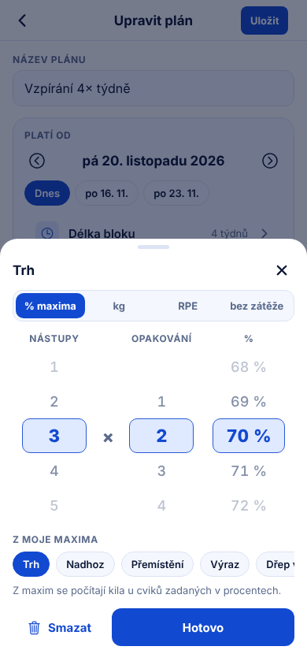
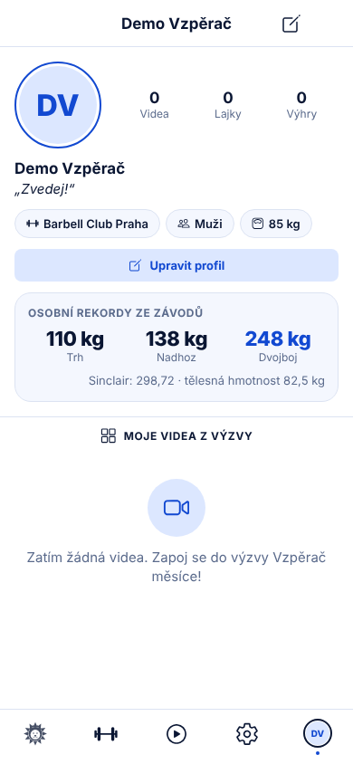

# Zvedej 🏋️

Mobilní aplikace pro vzpěrače z Čech a Moravy – tréninky, osobní rekordy, výzva **Vzpěrač měsíce**
ve stylu Instagram Reels a napojení na web Českého svazu vzpírání.

*By Sladký&Vejvoda*

| Úvod | Svaz | Tréninky | Plán – kolečka |
|---|---|---|---|
|  |  |  |  |
| **Zápis tréninku** | **Vzpěrač měsíce** | **Profil** | **Nastavení (tmavý režim)** |
|  |  |  |  |

## Sekce aplikace

Ovládání jako na Instagramu – spodní lišta s ikonami:

| Ikona | Sekce | Co umí |
|---|---|---|
| 🦁 lev | **Svaz (ČSV)** | Kalendář závodů (nadcházející, **proběhlé od 1. 1.**, **výsledky soutěží**) a novinky z [vzpirani.cz](https://www.vzpirani.cz). Závody jsou barevně odlišené: **MČR** červeně, **liga** modře, **ostatní** šedě. Vyhledávání vzpěračů a klubů, detail klubu s navigací, webem a sociálními sítěmi |
| 🏋️ činka | **Tréninky** | Viz níže |
| ▶️ | **Vzpěrač měsíce** | Videa na celou obrazovku (reels), lajk dvojklikem, téma měsíce, odpočet do konce hlasování, pořadí, síň vítězů, nahlášení nevhodného videa |
| ⚙️ | **Nastavení** | Světlý / tmavý / systémový režim, čeština / angličtina / slovenština, kg / lb, zaokrouhlování vah, výchozí osa, výchozí pauza mezi sériemi, vibrace, automatické přehrávání a ztlumení videí, viditelnost profilu ve vyhledávání, export tréninků, smazání účtu |
| 👤 fotka | **Profil** (vlevo nahoře **přátelé** a **zprávy**) | Jméno, příjmení, nepovinná fotka a motto, klub, pohlaví, rok narození, věková a hmotnostní kategorie, osobáky ze závodů (trh, nadhoz, dvojboj, Sinclair), mřížka nahraných videí, počet lajků a výher |

### Tréninky – jak jsou navržené

Tréninky se můžou měnit každý týden, ale klidně zůstat stejné měsíce. Proto:

- **Plán zůstává aktivní, dokud ho nezměníš.** Aplikace ukazuje, kolikátý týden plán běží (např. *Týden 5 z 8*).
- **„Změnit od příštího týdne“** – vytvoří kopii aktuálního plánu platnou od pondělí, kterou upravíš. Starý plán se
  uloží do archivu i s historií („běžel 6 týdnů“).
- **Týdenní progrese** – procenta se můžou automaticky zvedat každý týden (např. +2,5 %).
- **Nástupy × opakování × zátěž** se vybírají **rolovacími kolečky** (jako v iOS). Zátěž v % maxima, kg/lb, RPE
  nebo bez zátěže. Z procent se rovnou počítají kila podle tvých maxim.
- **Dnešní trénink** podle dne v týdnu → *Začít trénink* → odškrtáváš série, váhy upravíš kolečkem,
  automaticky naskočí odpočet pauzy.
- **Deník** po týdnech s tonáží, **zopakování** starého tréninku jedním klepnutím.
- **Nástroje:** moje maxima, kalkulačka kotoučů (barvy dle IWF), tabulka procent, Sinclairovy body, převod kg ↔ lb.
- **Šablony:** Klasika 3× týdně, Vzpírání 4× týdně, Pokročilý 5× týdně.
- Tréninky fungují **offline** (v posilovně bez signálu) a na pozadí se synchronizují na server.

### Vzpěrač měsíce – pravidla

- Téma se zveřejní vždy **1. den v měsíci** (tabulka `monthly_challenges`; když chybí, použije se záložní téma).
- Každý uživatel nahraje **jedno video měsíčně** (max. 60 s / 80 MB) – hlídá to databáze (`unique (user_id, month)`).
- Lajkovat lze jen videa **běžícího měsíce** a ne vlastní video.
- **Poslední den v měsíci o půlnoci** (pražský čas) se hlasování uzavře a databáze sama vyhlásí vítěze
  (nejvíc lajků, při shodě dříve nahrané video) – úloha `pg_cron`.
- Po 5 nahlášeních se video automaticky skryje.

### Váhové kategorie (IWF, platné od 1. 8. 2026)

| Skupina | Muži | Ženy |
|---|---|---|
| Muži/ženy, U23, junioři U20, masters | 60, 65, 70, 75, 85, 95, 110, +110 | 49, 53, 57, 61, 69, 77, 86, +86 |
| Dorost U17 | 55, 60, 65, 70, 75, 85, 95, +95 | 45, 49, 53, 57, 61, 69, 77, +77 |

Věkové skupiny: dorost U17 (15–17), junioři U20, U23, muži/ženy, masters 35–39 … 85+. Kategorie dětí do 15 let
v aplikaci nejsou. Aplikace podle roku narození nabídne jen skupiny, do kterých závodník patří, a umí navrhnout
kategorii podle tělesné hmotnosti. Definice jsou v `src/lib/categories.ts`.

### Kluby

51 klubů ze [seznamu ČSV](https://evidence.vzpirani.cz/Home/SeznamKlubu) rozdělených na Čechy a Moravu
(`src/data/clubs.ts`, v databázi tabulka `clubs`). Aktualizace jedním příkazem:

```bash
npm run update:clubs
```

## Technologie

- **Expo SDK 58** (React Native 0.88) + **Expo Router** – jedna kódová základna pro iOS, Android i web
- **Supabase** – přihlášení, PostgreSQL s Row Level Security, úložiště videí a fotek, Edge Function, `pg_cron`
- `expo-video` (reels), `expo-image-picker` (natáčení / výběr videa), `expo-image`, `react-native-svg`

```
src/app/            obrazovky (Expo Router) – (tabs)/ = spodní lišta
src/components/     UI komponenty (kolečka, reels, tréninky, profil …)
src/lib/            logika: kategorie, jednotky, tréninky, RSS parser, API (Supabase + demo)
src/providers/      nastavení/téma/jazyk, přihlášení, tréninková data
src/data/           kluby, cviky, šablony plánů, témata výzvy
supabase/           SQL migrace, seed, Edge Function csv-feed
```

## Spuštění

```bash
npm install
```

```bash
npx expo start
```

Bez souboru `.env` běží aplikace v **demo režimu** – vše se ukládá jen v zařízení a jsou v ní ukázkoví vzpěrači a
videa. Stačí klepnout na *Vyzkoušet bez účtu (demo)*. Aplikaci otevřeš v Expo Go (naskenuj QR kód),
v simulátoru nebo v prohlížeči (`w`).

## Napojení na Supabase (ostrý provoz)

1. Založ projekt na [supabase.com](https://supabase.com) (region Frankfurt).
2. V *Database → Extensions* zapni `pg_cron`.
3. Nahraj schéma a funkci (Supabase CLI):

   ```bash
   npx supabase link --project-ref <ref-projektu>
   ```

   ```bash
   npx supabase db push
   ```

   ```bash
   npx supabase functions deploy csv-feed --no-verify-jwt
   ```

4. Zkopíruj `.env.example` do `.env` a doplň `EXPO_PUBLIC_SUPABASE_URL` a `EXPO_PUBLIC_SUPABASE_ANON_KEY`.
5. Témata výzvy přidávej do tabulky `monthly_challenges` (příklad v `supabase/seed.sql`). Uživatelům se zobrazí
   až 1. den daného měsíce.

**Feedy ČSV:** mobilní aplikace čte RSS `vzpirani.cz/kalendar?action=atom` a `vzpirani.cz/aktuality?action=atom`.
Funkce `csv-feed` je cachuje 15 minut, takže ani 20 000 uživatelů nezatíží web svazu a funguje i webová verze
(web ČSV neposílá CORS hlavičky). Bez připojení se ukáže poslední uložená verze.

## Kapacita (~20 000 uživatelů)

- Počty lajků jsou předpočítané (`likes_count`) a indexované, vyhledávání používá trigramový index bez diakritiky.
- Všechny tabulky jsou chráněné RLS – uživatel může měnit jen svoje data.
- Videa: při 20 000 uživatelích a jednom videu měsíčně počítej s desítkami až stovkami GB úložiště a přenosů
  měsíčně → doporučený je **Supabase Pro** (případně později přesun videí na Cloudflare Stream / Mux).
  Na iOS se video při výběru překóduje na 1080p.

## Build do obchodů

```bash
npx eas-cli@latest build --platform all --profile production
```

## Co ještě doplnit

- **Logo ČSV (lev):** sekce zatím používá dočasnou ilustraci lva (`LionLogo` v `src/components/Logo.tsx`).
  Po dodání oficiálního loga ho stačí uložit do `assets/` a v komponentě vykreslit obrázek. Použití loga je
  vhodné odsouhlasit se svazem.
- Push notifikace (nové téma, vyhlášení vítěze) přes `expo-notifications`.
- Administrace témat a moderace nahlášených videí (zatím přímo v Supabase).


## Novinky ve verzi 1.1

- **Barvy české vlajky** (modrá `#0A3666`, červená `#C0000C`, bílá), světlý i tmavý režim. Barvy jsou na jednom místě: `src/lib/theme.ts`.
- **Plány** mají vlastní tlačítko nad přepínačem Dnes / Deník / Nástroje. Nový plán se tvoří **průvodcem ve 3 krocích** (základ → dny → cviky), plán má **celý kalendář** pro výběr data začátku.
- **Dny se pojmenují podle dne v týdnu**. Trénink přiřazený více dnům (např. Po + Čt) se jmenuje podle dne, kdy ho otevřeš.
- **Dnešní trénink jde upravit přímo v záložce Dnes** (tlačítko Upravit), změny se uloží do plánu.
- **Moje maxima**: lze přidat libovolný cvik, ze kterého se počítají procenta. Tabulka procent byla odstraněna.
- **Váhy jen v celých kilech** (žádné půlkilo). Kolečko pro výběr čísel se přesně „zacvakne“ do středu a cvakne při každém čísle.
- **Kalkulačka kotoučů**: kotouče se řadí od největšího po nejmenší, uzávěr je až za nimi, zobrazuje se jen jedna strana osy.
- **Časovač pauzy**: modrý podklad, červený pruh ubíhá zprava doleva, pod časem je další cvik s váhou; po skončení zvuk (gong / píšťalka / zvonek / bez zvuku, nastavuje se v Nastavení) a velké odškrtnutí dalšího nástupu.
- **Upozornění na pauzu na zamčené obrazovce** s tlačítkem „Odškrtnout nástup“ (`expo-notifications`, jen iOS/Android).
- Po dokončení tréninku rychlé reakce (Easy, Tak akorát, Docela na …, Dnes to nešlo).
- **Přátelé a zprávy**: žádosti o přátelství, soukromý chat. Zprávy od nepřátel se zobrazí v „Žádostech o zprávy“ (nejvýš 3 zprávy do odpovědi).
- Export tréninků do **PDF**. Nastavení bez volby „Systém“ a bez zaokrouhlování.

## Novinky ve verzi 1.2

- **Červená z loga ČSV** (`#C0000C`, stejný odstín jako činka a koruna lva) ve všech místech aplikace.
- **Bez zoomu**: aplikace se dá posouvat jen nahoru a dolů, přiblížení prsty i dvojitým klepnutím je vypnuté.
- **Sinclair 2021–2024** jako kalkulačka powerlifter.cz: muži A = 0,722762521, b = 193,609; ženy A = 0,787004341, b = 153,757.
- **Kalkulačka kotoučů**: jen levá část osy, kotouče, uzávěr a kousek osy za ním. Malé kotouče (0,5 / 1 / 1,5 / 2 kg) jsou zvlášť vpravo od uzávěru.
- **Úvodní obrazovka**: činka se dvěma červenými a jedním modrým kotoučem, uzávěrem a bílým půlkilem, nápis Zvedej je mezi kotouči.
- **Časovač pauzy**: červený podklad, modrá plynule ubývá s rozmazaným („mlhavým“) okrajem. Zvuky na konci pauzy jsou dvakrát delší a ostřejší.
- **Pauza na zamčené obrazovce**: iOS ukazuje Live Activity (`expo-widgets`) s odpočtem, pruhem a tlačítkem „Odškrtnout“ (tlačítko od iOS 17). Android ukazuje trvalé oznámení po dobu pauzy.
- **Sekce se po přepnutí otevře na výchozí záložce**: Svaz na Kalendáři závodů (Nadcházející), Tréninky na Dnes, Vzpěrač měsíce na Videích.
- Zvuk „Pípnutí“ nahradila **píšťalka** rozhodčího.
- **Export tréninků do PDF** funguje i ve webové verzi (PDF se vytvoří v telefonu a nabídne ke sdílení nebo stažení).

### Motivace a vzhled

- Zvuk konce pauzy na webu (aplikace na ploše iPhonu) se odemkne při odškrtnutí série, takže zazní po každé pauze (`src/lib/restSound.web.ts`).

- Písmo **Plus Jakarta Sans** pro nadpisy, čísla a tlačítka (běžný text je systémový); tlačítka a karty se při stisku pružně zmáčknou.
- Záložka **Dnes**: pozdrav s heslem „Vytrvalost a odhodlání přinášejí výsledky“, karta se sérií týdnů (plamen), kroužkem týdenního cíle a pásem 7 dní.
- Po dokončení tréninku **oslava** s konfetami a shrnutím (série, tonáž, čas, série týdnů).

### Zobrazení na počítači

Webová verze v okně širším než 900 px (`src/lib/layout.ts`) přepne rozložení: navigace je v panelu vlevo, obsah ve sloupci uprostřed,
Svaz ve dvou sloupcích (kalendář a novinky vedle sebe), videa Vzpěrače měsíce ve sloupci na výšku, vyskakovací panely jako dialog
uprostřed a přihlášení na dvě poloviny. Na telefonu (aplikace i web v mobilu) se nic nemění.

### Aktualizace dat ze svazu

```bash
npm run update:clubs
```

```bash
npm run update:feeds
```

První příkaz stáhne kluby, druhý kalendář včetně archivu proběhlých závodů, novinky a výsledky (uloží se jako záložní snímek `src/data/feedSnapshot.ts`).

### Omezení

- Živý odpočet na zamčené obrazovce funguje jen v nativní aplikaci (vývojový build `eas build --profile development` nebo build pro obchod), ne v Expo Go ani ve webové verzi na ploše iPhonu. Ve webové verzi to iOS neumožňuje.
- Loga klubů jsou v `assets/images/clubs/<id>.png` a `src/data/clubLogos.ts` (44 z 51 klubů, staženo z webů a facebookových stránek klubů). Kluby bez loga mají iniciály.
- Při migraci databáze nahraj i `supabase/migrations/20261123000000_social.sql` (přátelé a zprávy).

## Bezpečnost a ochrana údajů (verze 1.3)

- **Zásady ochrany osobních údajů a Podmínky použití** (cs/sk/en) – `src/data/legal.ts`, obrazovka `/legal/privacy` a `/legal/terms`
  (dostupné i bez přihlášení, odkazy v registraci a v Nastavení). Před spuštěním doplň údaje provozovatele v `OPERATOR`.
- **Registrace:** datum narození, minimální věk 15 let (kontrola v aplikaci i v databázi), nezaškrtnutý souhlas s podmínkami;
  datum souhlasu se ukládá do `profile_private`.
- **Nahlášení a blokování:** v profilu a chatu přes „⋯“, zprávu nahlásíš podržením. Blokace zruší přátelství
  a znemožní zprávy i žádosti (hlídá databáze).
- **Moderace:** správce (`profiles.is_admin = true`, nastaví se v SQL editoru) vidí v Nastavení → Správa → Nahlášení.
  Může nahlášení zamítnout, odstranit obsah nebo zablokovat účet; uživatel dostane oznámení s odůvodněním.
  Vyřízená nahlášení se po roce mažou.
- **Soukromí hmotnosti:** tělesná hmotnost je v `profile_private`, ostatním se ukáže jen po zapnutí „Ukázat hmotnost ostatním“.
- **Export dat:** Nastavení → Stáhnout všechna moje data (JSON, RPC `export_my_data`).

Nastavení správce (v Supabase SQL Editoru):

```sql
update public.profiles set is_admin = true
 where id = (select id from auth.users where email = 'tvuj@email.cz');
```

## Trenérský režim (verze 1.4)

- **Zapnutí:** Nastavení → Trenér → „Jsem trenér“. V Trénincích přibude tlačítko **Tým**.
- **Pozvání svěřenců:** odkazem, QR kódem (vytisknout do posilovny) nebo podle jména. Svěřenec musí souhlasit a vidí přesně,
  co trenér uvidí; tělesnou hmotnost sdílí jen se zvláštním souhlasem. Svěřenci do 18 let se mohou připojit jen k trenérovi
  ze svého klubu (hlídá databáze).
- **Přehled týmu:** poslední trénink (červeně po 7 dnech), tréninky tento týden, RPE, pocit, poznámky (např. bolest) a nepřečtené komentáře.
- **Detail svěřence:** deník, grafy (vývoj váhy u cviku, tonáž po týdnech), poslané plány.
- **Plány:** trenér plán vytvoří v Plánech a pošle ho jednomu, více svěřencům nebo celé skupině. Plán může být v procentech
  (přepočítají se z maxim každého svěřence), v kilech, podle RPE i bez zátěže. Úprava poslaného plánu se svěřencům promítne sama.
  Svěřenec plán od trenéra nemůže měnit, váhy si ale upraví přímo v tréninku.
- **Zpětná vazba:** komentáře u každého tréninku a soukromá videa nástupů (bucket `training-videos`, vidí je jen svěřenec a jeho trenéři).
- **Skupiny a žebříček:** tonáž a počet tréninků za měsíc, Sinclair z osobních rekordů.
- Databáze: migrace `supabase/migrations/20261126000000_coach.sql`.

## Bez registrace (verze 1.5)

- Na úvodní obrazovce „Začít hned bez registrace“ – anonymní přihlášení Supabase. Host si zapisuje tréninky, plány i maxima
  (synchronizují se na server pod anonymním účtem).
- Po prvním tréninku (oslava), na obrazovce Dnes a v Nastavení se nabízí „Vytvořit účet“: jméno, datum narození (15+),
  e-mail a souhlas. Po potvrzení e-mailu si uživatel nastaví heslo. Id uživatele i všechna data zůstanou.
- Zprávy, videa, lajky, přátelé, trenér a nahlášení jsou jen pro účty (hlídá i databáze – ochrana výzvy před falešnými hlasy).
- Hosté neaktivní 90 dní se automaticky mažou.
- Nastavení Supabase: Authentication → Sign In / Providers → zapnout **Allow anonymous sign-ins** a **Allow manual linking**;
  doporučeno zapnout CAPTCHA (Cloudflare Turnstile). Migrace `20261127000000_guest.sql`.

## Bez signálu (verze 1.5)

- Tréninky, plány i maxima se ukládají okamžitě do zařízení. Neodeslané změny čekají ve frontě a odešlou se samy
  po obnovení připojení, při návratu do aplikace nebo každých 30 s.
- Synchronizace slučuje data po záznamech (tréninky, plány, vlastní cviky, historie maxim). Trénink zapsaný offline
  na telefonu se tak nepřepíše změnami z počítače a smazané záznamy se nevracejí.
- Bez signálu ukazuje aplikace v Trénincích a při tréninku informaci, že se vše ukládá do telefonu.
- Web (PWA): service worker `public/sw.js` uloží celou aplikaci, takže se otevře i bez připojení.
  Seznam souborů a verzi mezipaměti vytváří `scripts/sw-manifest.mjs` při `npm run build:web`.

## Hodinky (verze 1.5)

- **Apple Watch:** oznámení o konci pauzy se na hodinkách zobrazí samo (když je iPhone zamčený) s tlačítky
  „Odškrtnout nástup“ a „+30 s pauza“. Live Activity s odpočtem má malé rozložení `bannerSmall`, které watchOS 11+
  ukazuje ve Smart Stacku.
- **Wear OS:** Android oznámení (trvalé během pauzy i na jejím konci) se zrcadlí na hodinky i s tlačítky.
- Akce z hodinek zpracuje `RestNotificationBridge` (odškrtnutí) a obrazovka tréninku (prodloužení pauzy).
- Samostatná aplikace přímo v hodinkách (watchOS/Wear OS) zatím není – vyžadovala by nativní cíl a sestavení v Xcode/Android Studiu.

## Ochrana dětí a právní soulad (verze 1.6)

- Registrace od 13 let s výběrem země. Do 15 let (Česko) / 16 let (Slovensko a jinde) je potřeba **souhlas zákonného zástupce**:
  dítě zadá e-mail rodiče, rodič na stránce `/parent/<token>` potvrdí souhlas (jméno, e-mail, prohlášení). Do té doby jen tréninkový deník.
  E-mail posílá Edge Function `parent-consent-mail` (Resend; bez klíče aplikace nabídne odkaz ke sdílení).
- Nezletilí: profil ve výchozím stavu skrytý, zprávy jen od přátel a vlastního trenéra (hlídá databáze).
- Odvolání proti rozhodnutí moderátora (DSA čl. 20) přímo v aplikaci; správce je vyřizuje v Nastavení → Správa.
- Při změně podmínek (`LEGAL_UPDATED`) aplikace požádá o nový souhlas.
- Zásady doplněny o děti, cookies/úložiště a předávání mimo EU; nová stránka Provozovatel a kontakt.
- Kontrolní seznam pro provozovatele: [`docs/COMPLIANCE.md`](docs/COMPLIANCE.md). Migrace `20261128000000_minors.sql`.

## Widget na plochu (verze 1.7)

- iPhone (SwiftUI, `src/widgets/TodayWidget.tsx`, malý a střední) a Android (Jetpack Compose, `src/widgets/TodayWidgetAndroid.tsx`):
  dnešní trénink z plánu (nebo „Dnes volno“), cviky, série týdnů a odtrénované dny týdne. Klepnutím se otevřou Tréninky.
- Data posílá `HomeWidgetBridge` při každé změně tréninků; na iOS se widget o půlnoci sám přepne na další den.
- Potřebuje nový build přes EAS (není v Expo Go ani na webu).

## Technická kvalita (verze 1.7)

- Automatické testy (`npm test`, Jest + jest-expo, složka `__tests__/`): Sinclair, kotouče na ose, rychlý zápis,
  slučování dat při synchronizaci, plány od trenéra, regenerace, věk a souhlas rodičů, úplnost překladů.
- GitHub Actions (`.github/workflows/ci.yml`) při každém pushi spustí kontrolu typů, lint a testy.
- Když se v aplikaci něco pokazí, místo bílé obrazovky se ukáže chybová stránka s tlačítkem „Zkusit znovu“
  a možností poslat hlášení e-mailem (`src/components/ErrorScreen.tsx`).

## Sdílení, upozornění, knihovna plánů, rozcvičky, přehled týmu (verze 1.8)

- **Sdílecí karta** (`src/components/share/`): po tréninku a v detailu tréninku obrázek 1080 × 1920 (Instagram story)
  v barvách aplikace – souhrn tréninku nebo nový osobní rekord (`logRecords`). Mobil: `react-native-view-shot`
  + systémové sdílení; web: `html2canvas` + Web Share API / stažení.
- **Upozornění** (Nastavení → Upozornění, jen mobilní aplikace):
  - připomínka tréninku v plánovaný den v nastavený čas (bez plánu podle dnů, kdy obvykle trénuješ),
  - závody, které pořádá můj klub (2 dny předem),
  - push od trenéra (nový / upravený plán, komentář) a nové zprávy – posílá je databáze přes `pg_net`
    do Expo Push API (migrace `20261130000000_push_team.sql`, tabulka `push_tokens`).
- **Knihovna hotových plánů** (`/plan-library`, `src/data/templates.ts`): 8 plánů podle úrovně a cíle
  (začátečník, technika, síla, příprava na závod, podle RPE…), náhled a převzetí jedním klepnutím.
- **Rozcvičky a doplňky** (Nástroje → Rozcvičky a doplňky): vlastní seznamy i předlohy. V tréninku rozcvička
  k odškrtání a doplňky přidané na konec; ke dni plánu se ukládá kopie (vidí ji i svěřenec).
- **Trenér – přehled týmu** (Tým → Dnes): kdo dnes trénoval, kdo vynechal plánovaný trénink, kdo hlásí bolest
  nebo má nízkou připravenost a kdo dlouho netrénoval.

## Průvodce, návod a návrh vah (verze 1.9)

- **Úvodní průvodce** (`/welcome`): nový uživatel odpoví na 5 otázek (zkušenost, kolikrát týdně, cíl, trenér,
  maxima) a dostane doporučený plán z knihovny (`src/lib/recommend.ts`). Pak nabídka prohlídky.
- **Prohlídka ovládání** (`src/components/tour/`): jako v Native Land – krok za krokem zvýrazní prvek
  (spodní lišta, Plány, Dnes/Deník/Nástroje…) a vysvětlí ho. Prvky se označí `<TourTarget id="…">`.
- **Návod** (Nastavení → Návod a prohlídka, ikona ? vpravo nahoře): kompletní návod se všemi funkcemi
  a vyhledáváním (`src/data/help.ts`), tlačítko pro spuštění prohlídky.
- **Návrh vah podle formy** (`src/lib/suggest.ts`): nízká připravenost → nabídka ubrat 5 %;
  cvik minule lehce (RPE ≤ 7) → +2,5 kg; minule těžce → držet váhu.
