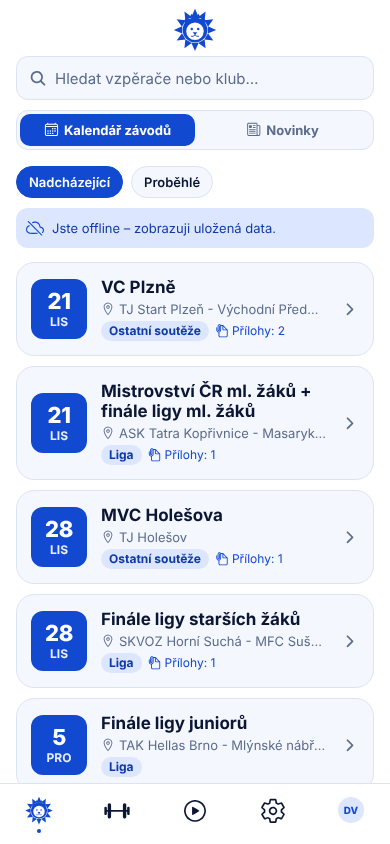
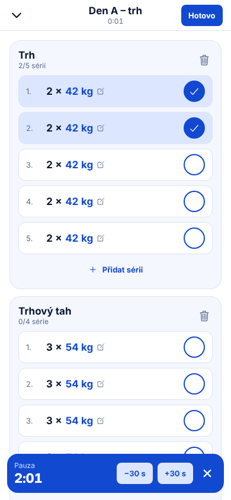
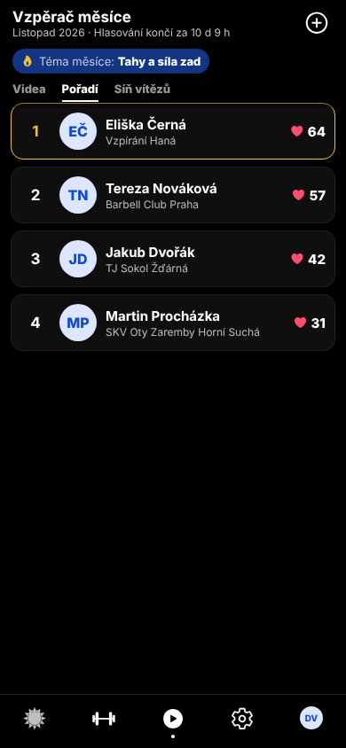

# Zvedej 🏋️

Mobilní aplikace pro vzpěrače z Čech a Moravy – tréninky, osobní rekordy, výzva **Vzpěrač měsíce**
ve stylu Instagram Reels a napojení na web Českého svazu vzpírání.

*By Sladký&Vejvoda*

| Úvod | Svaz | Tréninky | Plán – kolečka |
|---|---|---|---|
|  |  |  |  |
| **Zápis tréninku** | **Vzpěrač měsíce** | **Profil** | **Nastavení (tmavý režim)** |
|  |  |  |  |

## Sekce aplikace

Ovládání jako na Instagramu – spodní lišta s ikonami:

| Ikona | Sekce | Co umí |
|---|---|---|
| 🦁 lev | **Svaz (ČSV)** | Kalendář závodů (nadcházející, **proběhlé od 1. 1.**, **výsledky soutěží**) a novinky z [vzpirani.cz](https://www.vzpirani.cz). Závody jsou barevně odlišené: **MČR** červeně, **liga** modře, **ostatní** šedě. Vyhledávání vzpěračů a klubů, detail klubu s navigací, webem a sociálními sítěmi |
| 🏋️ činka | **Tréninky** | Viz níže |
| ▶️ | **Vzpěrač měsíce** | Videa na celou obrazovku (reels), lajk dvojklikem, téma měsíce, odpočet do konce hlasování, pořadí, síň vítězů, nahlášení nevhodného videa |
| ⚙️ | **Nastavení** | Světlý / tmavý / systémový režim, čeština / angličtina / slovenština, kg / lb, zaokrouhlování vah, výchozí osa, výchozí pauza mezi sériemi, vibrace, automatické přehrávání a ztlumení videí, viditelnost profilu ve vyhledávání, export tréninků, smazání účtu |
| 👤 fotka | **Profil** (vlevo nahoře **přátelé** a **zprávy**) | Jméno, příjmení, nepovinná fotka a motto, klub, pohlaví, rok narození, věková a hmotnostní kategorie, osobáky ze závodů (trh, nadhoz, dvojboj, Sinclair), mřížka nahraných videí, počet lajků a výher |

### Tréninky – jak jsou navržené

Tréninky se můžou měnit každý týden, ale klidně zůstat stejné měsíce. Proto:

- **Plán zůstává aktivní, dokud ho nezměníš.** Aplikace ukazuje, kolikátý týden plán běží (např. *Týden 5 z 8*).
- **„Změnit od příštího týdne“** – vytvoří kopii aktuálního plánu platnou od pondělí, kterou upravíš. Starý plán se
  uloží do archivu i s historií („běžel 6 týdnů“).
- **Týdenní progrese** – procenta se můžou automaticky zvedat každý týden (např. +2,5 %).
- **Nástupy × opakování × zátěž** se vybírají **rolovacími kolečky** (jako v iOS). Zátěž v % maxima, kg/lb, RPE
  nebo bez zátěže. Z procent se rovnou počítají kila podle tvých maxim.
- **Dnešní trénink** podle dne v týdnu → *Začít trénink* → odškrtáváš série, váhy upravíš kolečkem,
  automaticky naskočí odpočet pauzy.
- **Deník** po týdnech s tonáží, **zopakování** starého tréninku jedním klepnutím.
- **Nástroje:** moje maxima, kalkulačka kotoučů (barvy dle IWF), tabulka procent, Sinclairovy body, převod kg ↔ lb.
- **Šablony:** Klasika 3× týdně, Vzpírání 4× týdně, Pokročilý 5× týdně.
- Tréninky fungují **offline** (v posilovně bez signálu) a na pozadí se synchronizují na server.

### Vzpěrač měsíce – pravidla

- Téma se zveřejní vždy **1. den v měsíci** (tabulka `monthly_challenges`; když chybí, použije se záložní téma).
- Každý uživatel nahraje **jedno video měsíčně** (max. 60 s / 80 MB) – hlídá to databáze (`unique (user_id, month)`).
- Lajkovat lze jen videa **běžícího měsíce** a ne vlastní video.
- **Poslední den v měsíci o půlnoci** (pražský čas) se hlasování uzavře a databáze sama vyhlásí vítěze
  (nejvíc lajků, při shodě dříve nahrané video) – úloha `pg_cron`.
- Po 5 nahlášeních se video automaticky skryje.

### Váhové kategorie (IWF, platné od 1. 8. 2026)

| Skupina | Muži | Ženy |
|---|---|---|
| Muži/ženy, U23, junioři U20, masters | 60, 65, 70, 75, 85, 95, 110, +110 | 49, 53, 57, 61, 69, 77, 86, +86 |
| Dorost U17 | 55, 60, 65, 70, 75, 85, 95, +95 | 45, 49, 53, 57, 61, 69, 77, +77 |

Věkové skupiny: dorost U17 (15–17), junioři U20, U23, muži/ženy, masters 35–39 … 85+. Kategorie dětí do 15 let
v aplikaci nejsou. Aplikace podle roku narození nabídne jen skupiny, do kterých závodník patří, a umí navrhnout
kategorii podle tělesné hmotnosti. Definice jsou v `src/lib/categories.ts`.

### Kluby

51 klubů ze [seznamu ČSV](https://evidence.vzpirani.cz/Home/SeznamKlubu) rozdělených na Čechy a Moravu
(`src/data/clubs.ts`, v databázi tabulka `clubs`). Aktualizace jedním příkazem:

```bash
npm run update:clubs
```

## Technologie

- **Expo SDK 58** (React Native 0.88) + **Expo Router** – jedna kódová základna pro iOS, Android i web
- **Supabase** – přihlášení, PostgreSQL s Row Level Security, úložiště videí a fotek, Edge Function, `pg_cron`
- `expo-video` (reels), `expo-image-picker` (natáčení / výběr videa), `expo-image`, `react-native-svg`

```
src/app/            obrazovky (Expo Router) – (tabs)/ = spodní lišta
src/components/     UI komponenty (kolečka, reels, tréninky, profil …)
src/lib/            logika: kategorie, jednotky, tréninky, RSS parser, API (Supabase + demo)
src/providers/      nastavení/téma/jazyk, přihlášení, tréninková data
src/data/           kluby, cviky, šablony plánů, témata výzvy
supabase/           SQL migrace, seed, Edge Function csv-feed
```

## Spuštění

```bash
npm install
```

```bash
npx expo start
```

Bez souboru `.env` běží aplikace v **demo režimu** – vše se ukládá jen v zařízení a jsou v ní ukázkoví vzpěrači a
videa. Stačí klepnout na *Vyzkoušet bez účtu (demo)*. Aplikaci otevřeš v Expo Go (naskenuj QR kód),
v simulátoru nebo v prohlížeči (`w`).

## Napojení na Supabase (ostrý provoz)

1. Založ projekt na [supabase.com](https://supabase.com) (region Frankfurt).
2. V *Database → Extensions* zapni `pg_cron`.
3. Nahraj schéma a funkci (Supabase CLI):

   ```bash
   npx supabase link --project-ref <ref-projektu>
   ```

   ```bash
   npx supabase db push
   ```

   ```bash
   npx supabase functions deploy csv-feed --no-verify-jwt
   ```

4. Zkopíruj `.env.example` do `.env` a doplň `EXPO_PUBLIC_SUPABASE_URL` a `EXPO_PUBLIC_SUPABASE_ANON_KEY`.
5. Témata výzvy přidávej do tabulky `monthly_challenges` (příklad v `supabase/seed.sql`). Uživatelům se zobrazí
   až 1. den daného měsíce.

**Feedy ČSV:** mobilní aplikace čte RSS `vzpirani.cz/kalendar?action=atom` a `vzpirani.cz/aktuality?action=atom`.
Funkce `csv-feed` je cachuje 15 minut, takže ani 20 000 uživatelů nezatíží web svazu a funguje i webová verze
(web ČSV neposílá CORS hlavičky). Bez připojení se ukáže poslední uložená verze.

## Kapacita (~20 000 uživatelů)

- Počty lajků jsou předpočítané (`likes_count`) a indexované, vyhledávání používá trigramový index bez diakritiky.
- Všechny tabulky jsou chráněné RLS – uživatel může měnit jen svoje data.
- Videa: při 20 000 uživatelích a jednom videu měsíčně počítej s desítkami až stovkami GB úložiště a přenosů
  měsíčně → doporučený je **Supabase Pro** (případně později přesun videí na Cloudflare Stream / Mux).
  Na iOS se video při výběru překóduje na 1080p.

## Build do obchodů

```bash
npx eas-cli@latest build --platform all --profile production
```

## Co ještě doplnit

- **Logo ČSV (lev):** sekce zatím používá dočasnou ilustraci lva (`LionLogo` v `src/components/Logo.tsx`).
  Po dodání oficiálního loga ho stačí uložit do `assets/` a v komponentě vykreslit obrázek. Použití loga je
  vhodné odsouhlasit se svazem.
- Push notifikace (nové téma, vyhlášení vítěze) přes `expo-notifications`.
- Administrace témat a moderace nahlášených videí (zatím přímo v Supabase).


## Novinky ve verzi 1.1

- **Barvy české vlajky** (modrá `#11457E`, červená `#C0000C`, bílá), světlý i tmavý režim. Barvy jsou na jednom místě: `src/lib/theme.ts`.
- **Plány** mají vlastní tlačítko nad přepínačem Dnes / Deník / Nástroje. Nový plán se tvoří **průvodcem ve 3 krocích** (základ → dny → cviky), plán má **celý kalendář** pro výběr data začátku.
- **Dny se pojmenují podle dne v týdnu**. Trénink přiřazený více dnům (např. Po + Čt) se jmenuje podle dne, kdy ho otevřeš.
- **Dnešní trénink jde upravit přímo v záložce Dnes** (tlačítko Upravit), změny se uloží do plánu.
- **Moje maxima**: lze přidat libovolný cvik, ze kterého se počítají procenta. Tabulka procent byla odstraněna.
- **Váhy jen v celých kilech** (žádné půlkilo). Kolečko pro výběr čísel se přesně „zacvakne“ do středu a cvakne při každém čísle.
- **Kalkulačka kotoučů**: kotouče se řadí od největšího po nejmenší, uzávěr je až za nimi, zobrazuje se jen jedna strana osy.
- **Časovač pauzy**: modrý podklad, červený pruh ubíhá zprava doleva, pod časem je další cvik s váhou; po skončení zvuk (gong / pípnutí / zvonek / bez zvuku, nastavuje se v Nastavení) a velké odškrtnutí dalšího nástupu.
- **Upozornění na pauzu na zamčené obrazovce** s tlačítkem „Odškrtnout nástup“ (`expo-notifications`, jen iOS/Android).
- Po dokončení tréninku rychlé reakce (Easy, Tak akorát, Docela na …, Dnes to nešlo).
- **Přátelé a zprávy**: žádosti o přátelství, soukromý chat. Zprávy od nepřátel se zobrazí v „Žádostech o zprávy“ (nejvýš 3 zprávy do odpovědi).
- Export tréninků do **PDF**. Nastavení bez volby „Systém“ a bez zaokrouhlování.

## Novinky ve verzi 1.2

- **Červená z loga ČSV** (`#C0000C`, stejný odstín jako činka a koruna lva) ve všech místech aplikace.
- **Bez zoomu**: aplikace se dá posouvat jen nahoru a dolů, přiblížení prsty i dvojitým klepnutím je vypnuté.
- **Sinclair 2021–2024** jako kalkulačka powerlifter.cz: muži A = 0,722762521, b = 193,609; ženy A = 0,787004341, b = 153,757.
- **Kalkulačka kotoučů**: jen levá část osy, kotouče, uzávěr a kousek osy za ním. Malé kotouče (0,5 / 1 / 1,5 / 2 kg) jsou zvlášť vpravo od uzávěru.
- **Úvodní obrazovka**: činka se dvěma červenými a jedním modrým kotoučem, uzávěrem a bílým půlkilem, nápis Zvedej je mezi kotouči.
- **Časovač pauzy**: červený podklad, modrá plynule ubývá s rozmazaným („mlhavým“) okrajem. Zvuky na konci pauzy jsou dvakrát delší a ostřejší.
- **Pauza na zamčené obrazovce**: iOS ukazuje Live Activity (`expo-widgets`) s odpočtem, pruhem a tlačítkem „Odškrtnout“ (tlačítko od iOS 17). Android ukazuje trvalé oznámení po dobu pauzy.
- **Export tréninků do PDF** funguje i ve webové verzi (PDF se vytvoří v telefonu a nabídne ke sdílení nebo stažení).

### Aktualizace dat ze svazu

```bash
npm run update:clubs
```

```bash
npm run update:feeds
```

První příkaz stáhne kluby, druhý kalendář včetně archivu proběhlých závodů, novinky a výsledky (uloží se jako záložní snímek `src/data/feedSnapshot.ts`).

### Omezení

- Živý odpočet na zamčené obrazovce funguje jen v nativní aplikaci (vývojový build `eas build --profile development` nebo build pro obchod), ne v Expo Go ani ve webové verzi na ploše iPhonu. Ve webové verzi to iOS neumožňuje.
- Loga klubů: svaz je v evidenci neuvádí, ikona klubu proto zatím zobrazuje iniciály. Pole `logo` v `src/data/clubs.ts` je připravené.
- Při migraci databáze nahraj i `supabase/migrations/20261123000000_social.sql` (přátelé a zprávy).
